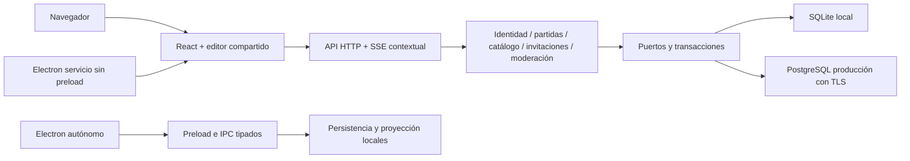

# Arquitectura y modelo de datos del servicio

## Composición

Composición del servidor en [src/server/index.ts](../src/server/index.ts) y [moderation-backend.ts](../src/server/moderation-backend.ts); reglas/casos de uso en `src/domain` y `src/application/services`; adaptadores en `src/infrastructure/server`. `src/web` contiene pantallas de acceso, cuentas, sistemas, partidas e invitados. `src/renderer/src` y `src/render` conservan editor y motor visual compartidos.

Electron local mantiene `contextIsolation`, `sandbox`, preload limitado y `nodeIntegration: false`. Electron servicio carga solo el origen permitido, sin puente privilegiado ni fallback a ventana local. El renderer no manipula DB ni archivos del servidor.

## Modelo lógico y autoridad

| Entidad / tablas | Relación y regla |
| --- | --- |
| Cuenta: `identity_user`, `identity_account` | Correo único, rol admin o dm, habilitación y cambio obligatorio; hash de contraseña en la cuenta de credencial. Varios administradores locales desde migración 7. |
| Sesión de cuenta: `identity_session` | Pertenece a una cuenta y tiene vencimiento/revocación; no es la sesión de juego. |
| Partida: `ttrpg_games` | Propietario DM, revisión, estado/archivo/borrado lógico y sistema/versión exactos. Estar ready no significa estar abierta. |
| Sistema: `system_catalog`, `system_versions` | Admin publica definición inmutable con hash; disponibilidad aparte del contenido. Manifest, reglas, esquema y presentaciones diferenciados. |
| Recurso: `owned_resources`, `owned_assets` | Clave por propietario e ID; escenas/bibliotecas con revisión y bindings. Assets bytes con tipo y hash. |
| Asociaciones: `game_resources`, `retained_templates` | Recursos compatibles con sistema de partida; definiciones privadas históricas retenidas sin publicarlas. |
| Apertura: `game_openings` | Una abierta por partida; generación, patrocinio DM y lease. Reabrir termina anterior y genera contexto nuevo. |
| Invitación: `game_invitations` | Una versión vigente por apertura; hash del secreto. Rotar no modifica participantes ya admitidos. |
| Participante: `guest_participants` | ID estable por admisión, alias y discriminador, estado admitido/salido/revocado. No es cuenta de usuario. |
| Credencial invitada: `guest_credentials` | Hash, participante, apertura/generación y vencimiento. Expulsar revoca todas las del objetivo. |
| Operaciones/auditoría | `owned_operations`, `guest_operations`, `owned_imports`, auditorías de identidad/invitación/moderación: deduplicación y resultados, sin conservar el secreto recuperable de una invitación. |

El esquema físico y constraints están en [migrations.ts](../src/infrastructure/server/database/migrations.ts). Orden vigente: 1 catálogo, 2 identidad, 3 propiedad/aperturas, 4 sistemas retenidos, 5 invitaciones/participantes, 6 moderación, 7 múltiples administradores. No editar migraciones ya aplicadas para implementar una nueva decisión.

## Fronteras HTTP y de datos

- `/api/v1/identity` autentica cuentas; `/api/v1/admin/systems` permite gestión administrativa de catálogo.
- `/api/v1/dm` opera recursos propios y partidas del DM. No aceptar un ownerId arbitrario como identidad verificada.
- `/api/v1/games/:gameId` admite invitados y sirve su proyección; `/api/v1/dm/games/:gameId` opera la mesa como propietario.
- Cookies separadas por audiencia, Host/Origin exactos y autorización vigente al confirmar/entregar. Las rutas globales legadas responden 404.
- Solo la proyección pública cruza hacia jugadores: sin notas, fichas completas, plantillas, mapas inactivos ni dados privados. SSE externo usa protocolo 2 con apertura/generación; el estado interno reutilizado mantiene su versión propia.

Contratos exactos, cuotas, estados y códigos HTTP en [API](guias/private-api.md), [propiedad](guias/owned-data.md), [invitaciones](guias/invitations.md) y [moderación](guias/moderation.md). No duplicar DTOs ni tablas en nuevas vistas.

## Persistencia y portabilidad

SQLite y PostgreSQL comparten puertos asíncronos y transacciones, con drivers separados. Un único proceso API mantiene autoridad por base. Escenas, assets, identidad y admisiones persisten; proyección, conexiones, cámaras y dados son efímeros. Reiniciar requiere publicar de nuevo, sin inventar presencia desde una fila de apertura.

`.ttrpgscene` v2 es intercambio de escena, con lectura/migración v1; no es backup de cuentas, sistemas o blobs. El paquete funcional operativo v3 conserva contenido/catálogo/bindings sin credenciales. El respaldo integral de DB sí contiene identidad y exige permisos privados e invalidación de accesos al restaurar. Consulta [operación](guias/service-operations.md).
