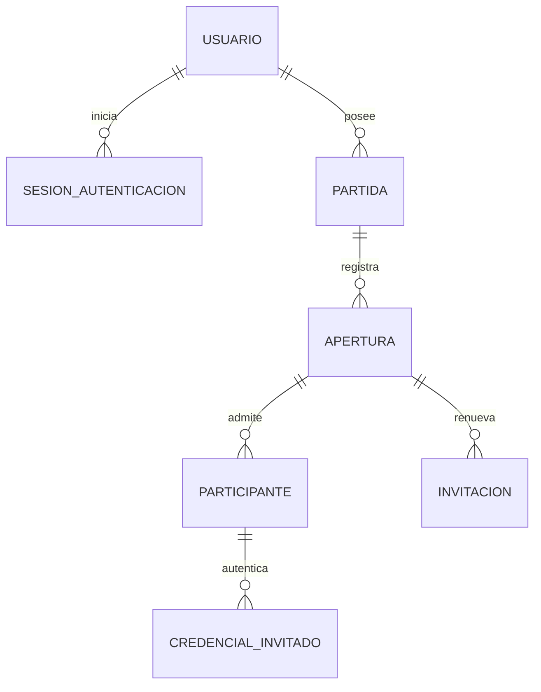

# Cuentas DM, partidas e invitaciones privadas

## Petición y decisiones confirmadas

2026-10-29. El usuario pide recomendar un manejador/modelo de usuarios, crear DMs con contraseña segura, permitirles crear múltiples partidas, invitar jugadores mediante enlace con id y secreto renovable, pedir alias al entrar y disponer de un panel para expulsarlos. Al expulsar cambia el secreto del enlace y los demás jugadores conservan su acceso. Al volver a iniciar una partida el DM obtiene un enlace nuevo.

Confirmó: **solo el administrador crea o invita DMs**. Añadió explícitamente **multi-DB: SQLite local y PostgreSQL en producción**. No usar SQLite en producción del servicio; Electron local conserva SQLite.

Recomendación adoptada para especificar: **Better Auth**, con adaptadores SQLite/PostgreSQL y credenciales/sesiones administradas por la biblioteca, detrás de una frontera de aplicación. No usar su identidad de usuario como identidad de jugador invitado ni delegar reglas de partidas a un plugin de organizaciones. Versión publicada consultada por pnpm el 2026-10-29: 1.7.14; confirmar y fijar versión al implementar 007. No introducir proveedor cloud obligatorio.

Fuentes primarias consultadas:
- https://better-auth.com/docs/authentication/email-password — autenticación de cuentas y configuración del hash.
- https://better-auth.com/docs/adapters/sqlite y https://better-auth.com/docs/adapters/postgresql — ambos motores y migraciones.
- https://better-auth.com/docs/concepts/session-management — sesiones y revocación; desactivar caches que retrasen revocación.
- https://cheatsheetseries.owasp.org/cheatsheets/Password_Storage_Cheat_Sheet.html — Argon2id recomendado; scrypt de Node es alternativa con coste de memoria adecuado. Nunca hash rápido para contraseñas.
- https://cheatsheetseries.owasp.org/cheatsheets/Session_Management_Cheat_Sheet.html — cookies y separación de identificadores/credenciales.
- https://node-postgres.com/features/transactions — transacciones en el mismo cliente/conexión.

## Fronteras y modelo propuesto

Se distinguen cuenta, sesión de autenticación, partida persistida, apertura de partida e ingreso de un jugador. Los nombres definitivos quedan en las specs; evitar usar «sesión» ambiguamente en código.

| Entidad | Responsabilidad |
| --- | --- |
| Usuario/cuenta de Better Auth | ID estable, email normalizado único, nombre, rol administrador/DM, estado y hash versionado con sal. Credencial separada; nunca contraseña en claro. |
| Sesión de autenticación de DM | Cookie HttpOnly, Secure en HTTPS, caducidad y revocación del lado servidor. Sin credenciales en localStorage. |
| Partida | UUID/id público opaco, propietario DM, nombre, fechas y estado. Un DM puede crear muchas; sin acceso entre propietarios. |
| Apertura de partida | Generación/época y estado activo, presencia del anfitrión y vencimiento de su lease. Se renueva al iniciar/reabrir explícitamente; no por cada reconexión SSE. |
| Invitación | Verificador hash de secreto aleatorio de 256 bits, generación y expiración. Enlace /jugar/<id>#invitacion=<secreto>; no query para el secreto. |
| Participante invitado | ID estable aleatorio, partida/apertura, alias visible, estado admitido/expulsado/salió, fechas. Alias no es identidad fiable ni concede permisos. |
| Credencial del participante | Token aleatorio independiente de la invitación, hash servidor, expiración, revocación. Cookie restringida a contexto de partida. |
| Auditoría mínima | Actor, acción, partida/participante y fecha. Sin contraseñas, cookies ni secretos de invitación. |

## Persistencia multi-DB

Puertos de repositorio/casos de uso asíncronos. Implementaciones SQLite y PostgreSQL detrás de composición explícita; no ramificaciones de dialecto en dominio/React. Migraciones versionadas por motor y suite de contrato idéntica ejecutada contra **ambos motores reales**. Las diferencias SQL, blobs/bytea, JSON, timestamps, booleanos, UPSERT y transacciones quedan en infraestructura. Usar pg.Pool en PostgreSQL con transacción sobre un único cliente; no simular PostgreSQL con SQLite ni omitir sus tests silenciosamente.

Configuración mediante .env: TTRPG_DB_DRIVER=sqlite|postgres y TTRPG_DATABASE_URL privada para postgres. Contrato de producción explícito (TTRPG_DEPLOYMENT=local|production), sin confundir NODE_ENV del build con despliegue remoto. Producción requiere postgres y transporte PostgreSQL verificado conforme al despliegue, jamás fallback silencioso a SQLite o TLS sin verificar. Secretos del driver fuera del frontend y errores. SQLite conserva permisos/directorio físico y exclusión; PostgreSQL no depende del filesystem local para datos funcionales del servicio. Formato .ttrpgscene v2 permanece compatible.

La abstracción abarca finalmente **escenas, assets y bibliotecas**, no solo cuentas. 006 prepara infraestructura/migraciones; 008 adapta todo almacenamiento funcional e incorpora propiedad y exportación/importación de datos con respaldo. Mientras queden rutas legadas SQLite, el arranque productivo nuevo debe fallar claramente, no anunciar una entrega PostgreSQL completa prematuramente.

## Reglas de invitación y moderación

- Solo un DM propietario autenticado inicia/reabre su partida. Muchos DMs y partidas pueden coexistir; motores de proyección, SSE, autorización de assets y dados aislados por partida. Los recursos privados pertenecen al DM y pueden reutilizarse en sus partidas; no se duplican bibliotecas por partida.
- Invitaciones admiten jugadores solo con anfitrión activo. Definir lease de presencia y gracia de reconexión en specs; una caída breve no rota ni expulsa a todos. Reabrir explícitamente o tras cierre/lease vencido crea otra apertura y vuelve inválidos enlaces previos. No rotar por heartbeat o refresco ordinario de página conectado.
- Invitación se canjea por POST con alias; fragmento eliminado con history.replaceState antes de cargar recursos opcionales. Referrer-Policy no-referrer. Nunca secreto en logs, analytics o llamadas GET.
- Expulsar es transacción de servidor: revocar participante/todas sus credenciales y rotar invitación. Los participantes admitidos restantes conservan sus credenciales. Joins concurrentes y operaciones en vuelo se revalidan; no basta ocultar la UI o cerrar un socket.
- El expulsado pierde HTTP/SSE/assets/dados de esa partida inmediatamente al terminar la operación; UI limpia la proyección y no intenta reconectar con credenciales revocadas. Datos ya descargados no pueden recuperarse.
- Un alias no prueba identidad. No se promete expulsión permanente de una persona sin cuenta: quien reciba un enlace posterior puede intentar volver con otro alias/navegador. La UI explica el cambio del enlace; el DM decide a quién compartirlo.
- Alias legible de 1–40 caracteres normalizados, sin controles invisibles/bidi peligrosos ni HTML. Permitir alias repetidos con discriminador visual estable para no expulsar al equivocado.
- Administrador de cuentas no recibe acceso implícito a escenas privadas de otro DM. Sin registro público ni bootstrap web abierto.

Las specs 008–010 concretan la presencia con heartbeat cada 10 segundos, contacto fresco durante 30 segundos y 120 segundos adicionales de gracia. En gracia no entran nuevos jugadores; los existentes conservan su identidad. Al vencer, volver requiere una apertura nueva. Estos plazos son decisiones técnicas iniciales, no opciones ya implementadas.

El primer despliegue admite un proceso de API por base de datos, con varias partidas concurrentes. La exclusión entre procesos debe comprobarse antes de servir para garantizar revocación de todas las conexiones. PostgreSQL permite separar y administrar la base; esta entrega no promete distribución horizontal de SSE. Al añadirla en el futuro hará falta coordinar presencia, eventos y revocación entre procesos.

## Transición y ejecución

Base integrada: main e1fd3ee (3.6.0). Hay trabajo autorizado .env/URL en feature/configuracion-env sin commit (3.7.0); se copió exactamente como prerrequisito a un checkout aislado, conservando el original. No se copiaron .env reales, claves ni datos personales. Ver prerrequisitos-autenticacion.json. Checkout de construcción: /Users/minrock/.codex/worktrees/autenticacion-mesas/ttrpg-effects. El orquestador refleja expedientes y tablero en el repo original solo para el dashboard existente; el código canónico de esta serie está en el checkout aislado.

Esta invocación autoriza especificar y comenzar el ciclo de desarrollo. Se ejecutará primero 006 hasta su revisión/decisión ; 007–011 se especifican y quedan en cola según dependencias. No se transfieren a esta serie los permisos de commit/merge dados para 001–005. Sin staging/commit/push/merge, DMG ni despliegue. Los roles escriben únicamente sus artefactos; solo constructor modifica implementación. Revisiones: máximo dos rondas por ciclo, esperar cuatro y conservar evidencias.

El servicio actual no cambia de autenticación hasta el corte integrado de 011; los incrementos backend quedan explícitos como transición y no conceden a las nuevas cuentas acceso a la mesa global anterior. El corte eliminará claves globales y rutas de login antiguas, adoptará datos legados solo con propietario explícito y conservará Electron local.

## Secuencia

006 Persistencia multi-DB → 007 Cuentas DM → 008 Partidas y propiedad → 009 Invitaciones → 010 Expulsión/SSE → 011 Frontend y migración final.

## Continuación de 007 a 011

Tras la aprobación técnica de 006, el usuario ordenó «continua con 007 a 011». Queda reemplazado el límite de ejecución anterior: ahora se implementan y revisan secuencialmente los cinco trabajos restantes. Se mantiene el checkout aislado y la rama efectiva `feature/factory-006-persistencia-multidb`, conservando todos los cambios previos sin commits ni merge. Una aprobación técnica desbloquea la siguiente dependencia aunque su tarjeta espere integración. Los expedientes guardan huellas propias antes de cada construcción y en cada ronda; la aprobación de una versión anterior sigue vinculada a esas huellas históricas, no a futuros cambios acumulados.

La configuración y los datos del servicio original permanecen fuera de las pruebas. Cada trabajo debe entregar evidencia real contra SQLite y PostgreSQL; 011 completa el cambio de autenticación y la experiencia web/Electron. Se conservan el límite de dos rondas por ciclo y los informes de cada etapa.

## Cambio de sistemas y plantillas autorizado — 2026-10-30

El usuario aprobó catálogo de sistemas con versiones y separación entre reglas, modelo de datos y presentación. En el ciclo2 de008 se reemplaza la propiedad editable por DM de plantillas del servicio por administración exclusiva de catálogo: el admin publica versiones y puede deshabilitarlas para nuevos usos, nunca borrarlas. Referencias existentes conservan contenido y reglas. No se concede al admin acceso a recursos privados de los DMs. Partidas referencian una versión estable; el sistema se transmite a clientes mediante contratos resueltos. Registro tipado de módulos incorporados prepara plugins futuros; instalación de plugins de terceros y ejecución dinámica quedan fuera del alcance actual. La spec vigente de008 concreta semántica, migración y concurrencia. Es una decisión autorizada, no evidencia de implementación.

009/010 deben preservar la referencia de sistema en el contexto por partida/apertura sin volver a un estado global. 011 debe consumir el catálogo y adaptar herramientas/fichas del viewport compartido, ofrecer selección de sistema y respetar las versiones deshabilitadas existentes; no presentar borrado de plantillas en servicio ni controles de edición para DM. Electron autónomo conserva su biblioteca local. Antes de construir cada dependencia se reconciliará su spec con la entrega real de008; no adelantar aprobación ni implementar al mismo tiempo.
